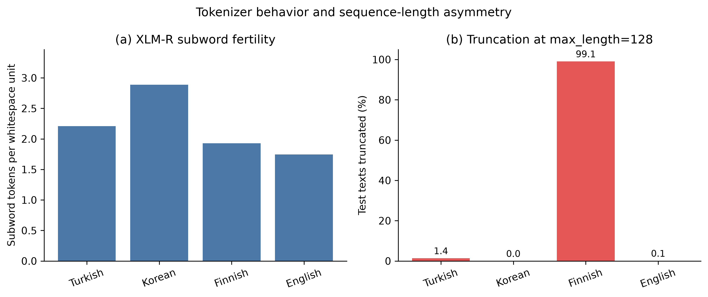
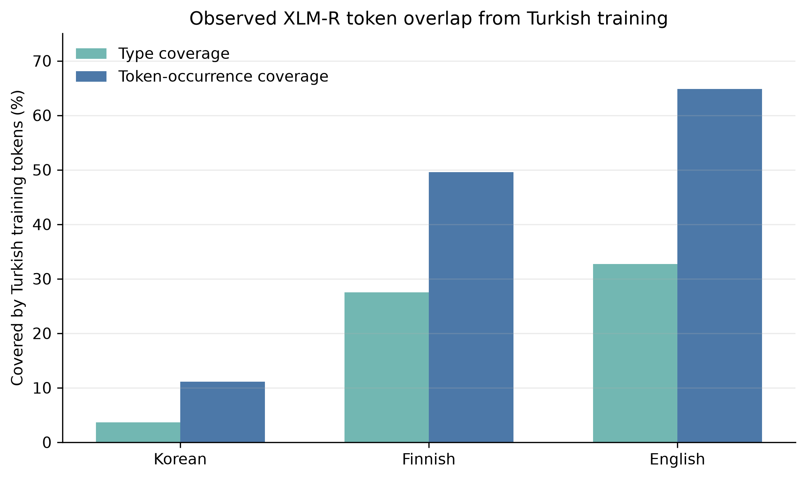
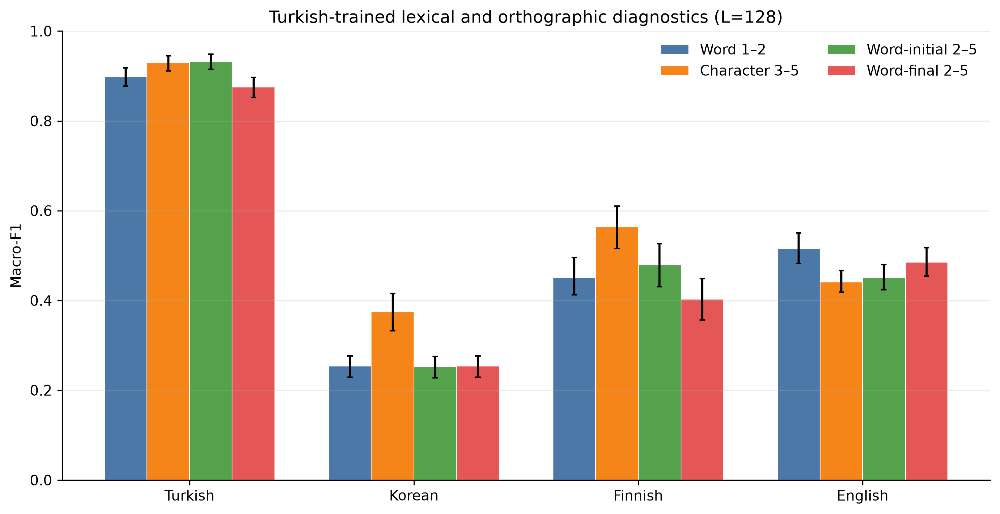

# Morphology, script, and data comparability in cross-lingual abusive-language detection: An audited study of Turkish, Korean, Finnish, and English

Habibe Karayiğit^1,*^, Meryem Berrin Bulut^2^

^1^ General Directorate of Secondary Education, Ministry of National Education, Adana, Turkey  
^2^ Department of Psychology, Faculty of Sciences and Letters, Çukurova University, Adana, Turkey  
*Corresponding author: habibekarayigit@aof.anadolu.edu.tr

> **WORKING-DRAFT STATUS — NOT YET READY FOR SUBMISSION.** Every numerical result in this version is reproducible from the repository's audited data, tokenizer analysis, or linear diagnostic outputs. The legacy encoder, Gemma, few-shot, transfer-matrix, joint-training, and translation results have been removed because the supplied notebook does not reproduce them on the corrected splits. They must be re-run on a CUDA runtime before a final model-comparison section is added.

## Abstract

Claims about typological effects in cross-lingual abusive-language detection can be distorted by incompatible task definitions, dataset splits, writing systems, and sequence-length choices. We audit a Turkish-source transfer setting involving Turkish, Korean, Finnish, and English and ask whether simple surface evidence supports an agglutinative-transfer explanation. We first harmonize the datasets under an umbrella binary abusive/offensive-language task, create fixed hash-based split manifests, remove duplicate and conflicting Turkish source texts before splitting, and retain official public splits where appropriate. The audit identifies substantial discrepancies in the earlier experimental specification: the supplied Turkish workbook contains 30,358 rather than 30,354 rows; a toxicity threshold of at least 4 in Finnish yields 392 rather than 157 positive examples; and the official TweetEval Offensive benchmark contains 14,100 rather than 11,916 examples across train, validation, and test.

Using the exact XLM-R tokenizer distributed with the earlier experiments, Korean shows the highest subword fertility (2.889), followed by Turkish (2.211), Finnish (1.931), and English (1.745). These values describe tokenizer behavior, not morphological complexity. More importantly, 436 of 440 Finnish test texts (99.1%) exceed the 128-token budget, and only 39.0% of their subword tokens are retained on average, compared with truncation rates of 1.4% for Turkish, 0% for Korean, and 0.1% for English. Observed target-token occurrence coverage by tokens appearing in the Turkish training set is 11.1% for Korean, 49.6% for Finnish, and 64.8% for English.

We additionally train four transparent logistic-regression controls on the same 8,000 Turkish examples using word, general character, word-initial, and word-final string features. At a common 128-token budget, general character n-grams obtain Macro-F1 scores of 0.374 for Korean and 0.563 for Finnish. A word-final string proxy for suffix information performs substantially worse: 0.254 for Korean and 0.403 for Finnish. Paired bootstrap analysis shows disadvantages of 0.120 for Korean and 0.161 for Finnish relative to general character features. The present verified evidence therefore does not support a direct shared-suffix explanation for cross-lingual transfer. Instead, it shows that script mismatch, observed subword overlap, task-definition differences, and severe length confounding must be controlled before a representation-level typological effect can be evaluated. These findings motivate a confirmatory morphology-aware encoder study using lemma, Universal Dependencies feature, and randomized-feature views on the audited splits.

**Keywords:** abusive language detection; cross-lingual transfer; agglutinative languages; data audit; morphological typology; tokenization; script effects.

## 1. Introduction

Social-media platforms support interaction across linguistic boundaries but also facilitate abusive, offensive, and hateful communication, with psychological and social consequences for targeted users [1–3]. Because the volume of user-generated content exceeds the capacity of manual moderation, automatic abusive-language detection has become an important problem in natural language processing.

Most progress has focused on English and a small number of well-resourced languages [4–7]. Cross-lingual transfer offers a practical response: a multilingual model trained with labeled data in one language can be applied to another language with little or no target-language supervision [8–12]. Transfer quality, however, varies with lexical overlap, script, pretraining coverage, domain, annotation definition, and typological proximity. These factors are often correlated and are difficult to isolate in comparisons assembled from independently developed datasets.

The original version of this study proposed that shared agglutinative morphology could facilitate transfer from Turkish to genetically unrelated agglutinative languages. That hypothesis is theoretically plausible: Turkish, Korean, and Finnish productively concatenate grammatical material, while sharing limited vocabulary and belonging to different language families [13,14]. However, grouping whole languages as “agglutinative” does not by itself identify a morphological mechanism. A convincing test must distinguish morphology from script overlap, tokenizer behavior, dataset composition, and label semantics.

The present revision therefore begins with an audit rather than assuming that the earlier language-level performance differences were typological. It also adopts the broader term **abusive/offensive-language detection**, because the source corpora operationalize different constructs: ATC labels abusive Instagram comments, BEEP! distinguishes hate, offensive, and neutral news comments, RTP-LX provides toxicity ratings for LLM-generated Finnish text, and TweetEval supplies offensive-language labels. Treating these labels as interchangeable instances of hate speech would overstate construct equivalence.

This audited stage addresses four research questions:

- **RQ1:** Are the dataset sizes, class distributions, and splits internally consistent and leakage-safe?
- **RQ2:** How do tokenizer fragmentation, truncation, script, and observed subword overlap differ across the evaluated languages?
- **RQ3:** Do transparent word-final features, used as an analyzer-free suffix proxy, transfer from Turkish more effectively to the available agglutinative targets than general lexical or character features?
- **RQ4:** Which controls are required before a multilingual encoder result can be interpreted as evidence for morphological transfer?

The contributions are: (1) fixed row-ID/hash manifests and corrected dataset tables; (2) an explicit audit of duplicate leakage and label-threshold errors; (3) a tokenizer/truncation analysis conducted on identical, declared test splits; (4) a paired-bootstrap comparison of word, character, word-initial, and word-final transfer controls; and (5) a clean experiment runner that records configurations and per-example predictions for the confirmatory encoder stage.

## 2. Related work

Multilingual encoders such as mBERT and XLM-R support zero-shot cross-lingual transfer [4,8]. Prior work shows that transfer is affected by script compatibility and lexical overlap [10,11], while broader surveys emphasize genealogical, syntactic, and typological factors [12]. In abusive-language detection, XLM-R has provided strong multilingual baselines [15,37,40], but performance varies substantially by language and dataset [37,38].

Agglutinative languages are a useful test case because words may encode multiple grammatical functions through concatenated morphology [13,14]. Yet a language-level contrast does not isolate morphology when each language is represented by a different platform, annotation scheme, class distribution, and average text length. Dataset harmonization and controlled perturbation are therefore necessary.

A second issue is construct alignment. Hate speech, offensiveness, abuse, aggression, and toxicity are related but non-identical categories [6,16,22–24,36]. Mapping them to one binary task may be useful operationally, but it must be reported as a harmonized abusive/offensive-language task rather than assumed to preserve a single semantic definition.

Finally, subword fertility is sometimes used to characterize tokenizer fit. It measures the number of model tokens required to represent whitespace-delimited words, not morphological complexity itself. Fertility can reflect script encoding, tokenizer vocabulary allocation, orthographic conventions, and domain-specific vocabulary. The present study therefore reports fertility alongside truncation and observed token overlap, and avoids treating it as direct typological evidence.

## 3. Materials and methods

### 3.1 Scope and language set

The verified analysis includes Turkish as the source language, Korean and Finnish as agglutinative targets, and English as a non-agglutinative comparison. Hungarian is not included in the audited results because the exact 655-row source file used in the legacy notebook is not present in the repository and cannot be reconstructed from the cached outputs. It will be added only after the file, license, label semantics, and immutable hash are available.

### 3.2 Dataset audit and task harmonization

All texts are mapped to a binary operational label: 1 denotes the source dataset's abusive, offensive, hate/aggressive, or thresholded-toxic category; 0 denotes its negative category. This is an umbrella transfer task and not a claim that the underlying constructs are identical.

#### 3.2.1 Turkish ATC

The supplied workbook contains 30,358 rows: 10,532 labeled 1 and 19,826 labeled 0. We apply NFKC normalization, Unicode case-folding, removal of zero-width characters, and whitespace collapsing only for duplicate grouping. The audit detects 992 exact duplicate rows, 1,071 repeated normalized texts, one blank text, and four normalized-text groups with conflicting labels (21 rows). Blank and conflicting groups are excluded; repeated normalized texts are represented once before splitting. A fixed stratified subset contains 8,000 training, 1,000 development, and 1,000 test examples. Hash manifests ensure that no normalized text crosses splits.

#### 3.2.2 Korean BEEP!

We pin the public repository at commit `f8d05dce2b22007bb149e5139c0060c68ad8f94b`. The `hate` and `offensive` classes are mapped to 1 and `none` to 0. The 7,896 labeled training examples are partitioned into 6,396 training examples, 500 development examples, and a 1,000-example adaptation pool. Because labels for the official public test file are undisclosed, the 471 labeled repository development examples are used as the transparent held-out test and are named as such.

#### 3.2.3 Finnish RTP-LX

The workbook contains 1,099 LLM-generated completions. `CompletionAnnotations.Toxicity` is integer-valued; consequently, the legacy code's threshold `>=3.5` is operationally identical to `>=4`. This rule produces 392 positives (35.7%) and 707 negatives, not 157 positives. Fixed splits contain 560 training, 99 development, and 440 test examples. The 440-example test contains 157 positives and 283 negatives.

Each threshold-positive completion also has a `BenignCompletion`, producing 392 paired prompt items. These are retained only as a diagnostic. They are not treated as morphology-controlled minimal pairs because toxic and benign variants differ greatly in length and content.

#### 3.2.4 English TweetEval Offensive

We pin TweetEval at commit `4fbd22cd78421f05b1ecdb4fc5725bc7a7bd8f66` and retain its official 11,916/1,324/860 train/development/test splits. Across all official splits, the dataset contains 14,100 examples, of which 4,640 are positive. Twelve normalized-text groups cross official split boundaries, and ten duplicate groups have conflicting labels somewhere in the dataset. Official splits are retained for comparability, while deduplicated sensitivity analysis is required for monolingual and few-shot claims.

### 3.3 Corrected split statistics

| Language | Split | Total | Negative (0) | Positive (1) | Positive % |
|---|---|---:|---:|---:|---:|
| Turkish | Train | 8,000 | 5,275 | 2,725 | 34.1 |
| Turkish | Dev | 1,000 | 659 | 341 | 34.1 |
| Turkish | Test | 1,000 | 659 | 341 | 34.1 |
| Korean | Train | 6,396 | 2,824 | 3,572 | 55.8 |
| Korean | Dev | 500 | 221 | 279 | 55.8 |
| Korean | Adaptation pool | 1,000 | 441 | 559 | 55.9 |
| Korean | Test (public BEEP dev) | 471 | 160 | 311 | 66.0 |
| Finnish | Train | 560 | 360 | 200 | 35.7 |
| Finnish | Dev | 99 | 64 | 35 | 35.4 |
| Finnish | Test | 440 | 283 | 157 | 35.7 |
| English | Train | 11,916 | 7,975 | 3,941 | 33.1 |
| English | Dev | 1,324 | 865 | 459 | 34.7 |
| English | Test | 860 | 620 | 240 | 27.9 |

### 3.4 Tokenization, truncation, and overlap analysis

We use the exact XLM-R tokenizer file stored with the legacy run. Full token counts are computed without truncation. Subword fertility is the corpus-level ratio of subword tokens to nonempty whitespace-delimited units. For the legacy `max_length=128` setting, 126 content tokens are available after special tokens. We report the number of texts exceeding this limit and the mean fraction of full tokens retained.

Observed target-token coverage is computed using token IDs present in the audited 8,000-example Turkish training set. Type coverage is the proportion of unique target test token IDs also observed in Turkish training. Occurrence coverage is the proportion of all target token occurrences whose IDs were observed in Turkish training. These are descriptive sample statistics, not causal typology measures.

### 3.5 Linear transfer diagnostics

Four TF-IDF views are trained on the same Turkish training split:

1. word unigrams and bigrams;
2. character-within-word 3–5-grams;
3. word-initial 2–5-character strings;
4. word-final 2–5-character strings.

The word-final view is an intentionally weak, analyzer-free proxy for suffix evidence; it cannot identify morpheme boundaries. Logistic regression uses `C=1.0`, L2 regularization, balanced class weights, and seed 42. All train and test texts are truncated with the XLM-R tokenizer to the same 128-token budget before feature extraction. Macro-F1 is primary. Paired 95% confidence intervals use 5,000 bootstrap samples of the same test-example indices.

### 3.6 Confirmatory encoder protocol

The repository now specifies a 30-run confirmatory matrix covering mBERT, XLM-R-base, XLM-R-large, and Glot500 over seeds 42, 123, and 456; a genuinely frozen XLM-R-base encoder; 128/256/512 length sensitivity; and XLM-R-base surface, lemma, UD-morphology, and randomized-morphology views. Each run must save its data hash, model revision, trainable-parameter count, development history, aggregate metrics, and per-example probabilities. These results are not included in the present working draft until executed on a CUDA runtime and verified as complete.

## 4. Results

### 4.1 Dataset audit

The audit changes several central quantities from the earlier manuscript. Turkish source counts differ by four positive examples, and duplicate removal changes the selected 10,000-example class distribution from the previously reported 34.7% to 34.1% positive. The Finnish positive rate is 35.7%, not 14.3%; the earlier number 157 is the count of positives in the 440-example test split, not in the full 1,099-row corpus. The English total is 14,100 when official development and test splits are included.

These discrepancies are not cosmetic. They affect class priors, few-shot sampling, reported confusion matrices, and the comparability of full-test and balanced-subset metrics.

### 4.2 Tokenization and truncation

| Language | N | Subword fertility | Texts truncated at L=128 | Mean retained-token fraction |
|---|---:|---:|---:|---:|
| Turkish | 1,000 | 2.211 | 14 (1.4%) | 99.7% |
| Korean | 471 | 2.889 | 0 (0.0%) | 100.0% |
| Finnish | 440 | 1.931 | 436 (99.1%) | 39.0% |
| English | 860 | 1.745 | 1 (0.1%) | 100.0% |

Korean has the highest fertility despite having the shortest texts and no truncation. Finnish has lower fertility than Turkish but extreme sequence truncation because the LLM-generated completions are much longer. Thus fertility and retained context capture different phenomena and should not be collapsed into one “morphological complexity” variable.

The paired Finnish diagnostic also contains a severe length cue. Benign completions have a median length of 194 characters and none exceed the 128-token content budget, whereas threshold-positive completions have a median of 1,205 characters and 388/392 (99.0%) are truncated. Performance on this pairing could therefore reflect length rather than toxicity or morphology.

### 4.3 Observed token overlap and script

| Target | Target type coverage by Turkish training | Target token-occurrence coverage by Turkish training |
|---|---:|---:|
| Korean | 3.6% | 11.1% |
| Finnish | 27.5% | 49.6% |
| English | 32.7% | 64.8% |

Korean's very low overlap is consistent with the Hangul/Latin script difference. English has the greatest observed overlap with Turkish despite being the non-agglutinative comparison. This makes a simple contrast between “agglutinative target” and English insufficient to isolate morphology.

### 4.4 Lexical and orthographic transfer controls

| Feature view | Turkish | Korean | Finnish | English |
|---|---:|---:|---:|---:|
| Word TF-IDF (1–2 grams) | 0.898 | 0.254 | 0.452 | 0.516 |
| Character TF-IDF (3–5 grams) | 0.929 | 0.374 | 0.563 | 0.441 |
| Word-initial strings (2–5 chars) | 0.932 | 0.252 | 0.479 | 0.451 |
| Word-final strings (2–5 chars) | 0.876 | 0.254 | 0.403 | 0.485 |

General character features are the strongest lightweight target representation for Korean and Finnish. In Korean, the character model reaches 0.374 Macro-F1, while the word, prefix, and suffix views remain near 0.252–0.254. The word model has no Turkish-trained feature for 465 of 471 Korean test documents; even the general character model has no feature for 317 documents. Punctuation and occasional Latin material explain part of the remaining overlap.

For Finnish, character features reach 0.563 Macro-F1. Word-final features reach only 0.403 and exhibit a strong positive bias: 79.1% of Finnish test examples are predicted positive although the gold positive rate is 35.7%. For English, word features perform best (0.516), and word-final features (0.485) exceed the general character model (0.441).

### 4.5 Paired-bootstrap comparisons

For Finnish, character n-grams outperform the word-final proxy by 0.161 Macro-F1 (95% CI [0.100, 0.221]) and outperform word features by 0.112 [0.052, 0.168]. Word-final features underperform word-initial features by 0.076 [0.012, 0.138]. Comparing the common L=128 budget with full text also changes the Finnish word-final score by +0.080 [0.039, 0.121] and the word-initial score by +0.127 [0.075, 0.179], whereas corresponding changes for the other languages are negligible. This confirms that length handling is a Finnish-specific design factor rather than a generic preprocessing detail.

For Korean, character features outperform word-final features by 0.120 [0.084, 0.155]. The difference between word-final and word-initial features is 0.001, with an interval including zero.

For Turkish, word-final features underperform word-initial features by 0.057 [0.038, 0.076]. English is the only target where word-final features exceed general character features: +0.044 [0.010, 0.078].

These controls provide no support for a direct shared-suffix-string explanation. This finding does not rule out abstract morphology encoded by multilingual transformers; it shows that a representation-level claim requires morphology-aware interventions rather than whole-language grouping or word-final overlap.

## 5. Discussion

### 5.1 What the verified evidence supports

The strongest verified finding is methodological: the earlier design contained dataset and sequence-length confounds large enough to alter the interpretation of cross-lingual results. Finnish is not merely another target language at `max_length=128`; almost its entire test set is truncated, whereas the other languages are effectively untruncated. English shares far more observed XLM-R token occurrences with Turkish than either Korean or Finnish, despite its role as the typologically dissimilar control. Korean's script sharply restricts direct lexical and character overlap.

The linear controls further show that word-final overlap is not a credible explanation for an agglutinative advantage. General character patterns outperform the suffix proxy in both available agglutinative targets. Consequently, any future encoder advantage must be tested against randomized morphology tags, lemma ablation, script controls, and length sensitivity.

### 5.2 What the verified evidence does not support

The present audited results do not justify the earlier claims that agglutinative targets outperform English by 8.4 percentage points, that larger and smaller encoders differ systematically in typological reliance, or that 50 target examples yield a particular improvement. Those values came from cached, state-dependent notebook runs that do not reproduce the manuscript's declared splits and, in the frozen baseline, combine incompatible implementations.

The four-language audited set also cannot support a statistically meaningful language-level correlation between typological features and performance. A Spearman coefficient based on a handful of languages gives each language excessive influence and confounds typology with dataset identity. The earlier morphological-correlation table should be removed rather than reinterpreted.

### 5.3 Implications for the confirmatory model study

A valid confirmatory study should satisfy five conditions. First, every model must use the same immutable manifests and full held-out examples. Second, Finnish must be evaluated at multiple sequence lengths and on a length-matched diagnostic. Third, morphology should be manipulated directly through lemma, UD feature, and randomized-feature views. Fourth, model differences should use paired example-level inference and multiple seeds. Fifth, the Hungarian condition should not be restored until its source file and labels are independently auditable.

### 5.4 Psychological and social implications

Language-specific false positives and false negatives remain socially important [1–3,50–53], but fairness conclusions require comparable evaluation conditions. A system exposed to only 39% of one language's test tokens is not being evaluated under the same informational condition as a system exposed to essentially 100% in another language. Correcting such design asymmetries is part of responsible multilingual moderation research.

## 6. Limitations

The source datasets operationalize different constructs and originate from different domains. Finnish text is LLM-generated and much longer than the user-generated corpora. The word-final diagnostic is an orthographic proxy, not a morphological analyzer, and cannot identify allomorphy, derivation, or morpheme boundaries. Only Turkish, Korean, Finnish, and English are currently audited; Hungarian remains unavailable. Finally, the confirmatory multilingual encoder matrix has not yet been executed on the corrected data, so this working draft deliberately makes no encoder-performance claim.

## 7. Conclusion

After data and code auditing, the available evidence does not support a strong claim that shared agglutinative morphology by itself facilitates cross-lingual abusive-language transfer. Instead, the verified results identify three dominant design factors: script and observed token overlap, severe Finnish sequence truncation, and incompatible dataset/label constructions. Surface suffix features do not transfer preferentially to Korean or Finnish; general character features perform substantially better.

The appropriate next step is not to add further unrelated baselines to the legacy tables. It is to run the pre-specified morphology-aware encoder matrix on the corrected manifests, include length-matched and randomized-feature controls, and retain example-level predictions for paired inference. Until that confirmatory stage is complete, the study should be presented as an audited methodological analysis rather than evidence for a typological transfer advantage.

## Data and code availability

The repository includes file hashes, split manifests, dataset summaries, tokenization statistics, linear-diagnostic predictions, bootstrap outputs, and a clean encoder runner. Raw or processed text is excluded from generated Git artifacts where redistribution may be restricted. Public Korean and English sources are fetched from pinned Git commits. The exact Hungarian source file is required before that condition can be reproduced.

## References

The reference list from the original manuscript is retained. Before submission, references should be renumbered after removal of unsupported Gemma, translation, and legacy-result sections, and additional work on morphology-aware multilingual modeling and controlled challenge sets should be added.
